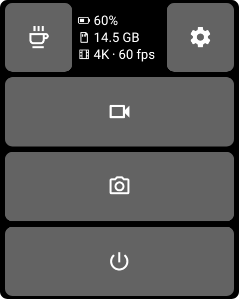
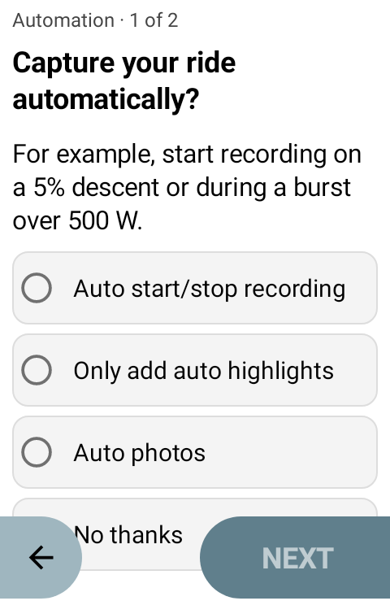
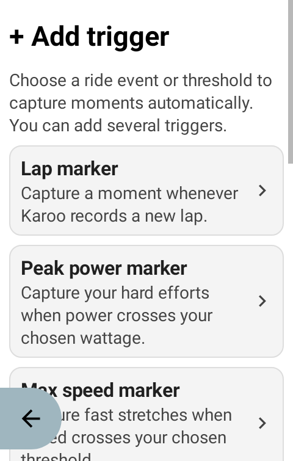
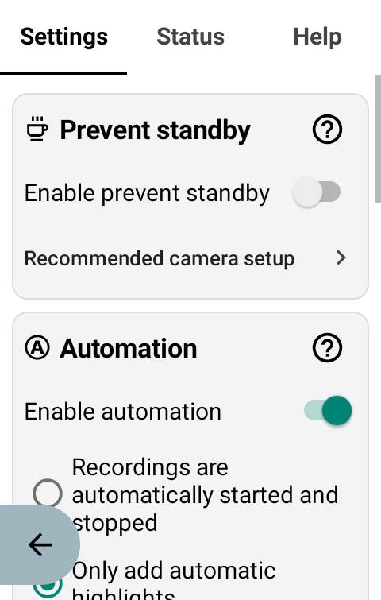

  

# AeroCam

**Website:** [mtenkoppel.github.io/AeroCam](https://mtenkoppel.github.io/AeroCam/)

AeroCam is an independent Karoo extension for controlling a DJI Osmo Action
camera over Bluetooth Low Energy. It provides in-ride camera controls, automatic recording and photos, video highlights, GPS telemetry,
automatic reconnection, and a configurable keep-awake mode.

**[Download the latest release](https://github.com/mtenkoppel/AeroCam/releases/latest)** ·
[Installation steps](#install-on-your-karoo) · [Screenshots](#screenshots) ·
[Compatibility](#compatibility)

## New in 1.1

Let your ride trigger recordings, highlights, or photos. Choose a mode, add your triggers, and keep your attention on the ride. Automatic recordings stop after a quiet minute by default; automatic photos are at least two minutes apart. Both intervals are adjustable, and manual recording stays available.

The new setup guide walks you through automation. Refined camera controls share consistent spacing, clearer labels, and an **A** inside the icon when automation is armed.

[Download AeroCam 1.1.0](https://github.com/mtenkoppel/AeroCam/releases/tag/v1.1.0). Install over the existing app to keep pairing and settings.

## Install on your Karoo

**Start here: [open the latest AeroCam release](https://github.com/mtenkoppel/AeroCam/releases/latest).**
You do not need to build anything or use developer tools.

### Install with your phone

You need a **Karoo 3**, connected to Wi-Fi, and the **Hammerhead Companion App**
set up with your Karoo on a phone with an internet connection. Update the Karoo
and Companion App before starting.

1. On your **phone**, open the [latest release](https://github.com/mtenkoppel/AeroCam/releases/latest)
   and expand **Assets** if the downloads are hidden.
2. Find the file ending in **`.apk`**, such as **`AeroCam-v1.0.apk`**. This is the
   app to install. You can ignore the `.sha256` and **Source code** downloads.
3. **Press and hold the APK link**, choose **Share**, then select the
   **Hammerhead Companion App**.
4. Wait for the transfer, then tap **Install on your Karoo** to finish.
5. Open AeroCam from the Karoo's **Extensions** library and follow the camera
   pairing and setup guide. Then add AeroCam data fields to your ride pages.

For illustrated steps and requirements, see
[Hammerhead's official installation guide](https://support.hammerhead.io/hc/en-us/articles/31576497036827-Companion-App-Sideloading).
If the Companion App is missing from the share menu, try downloading the APK to
your phone first, then share the downloaded file with the Companion App.

### Update AeroCam

Check the release notes, then install the new release APK using the same steps.
You can also check for updates on the app's details page on Karoo when it was
installed from a GitHub URL. **Keep the existing app installed** so your settings
and paired camera are preserved. If an update fails, ask for help through
[GitHub Issues](https://github.com/mtenkoppel/AeroCam/issues) before uninstalling.

> [!TIP]
> **Built with AI. Shaped and proven by a human.** AeroCam combines AI-driven
> development with hands-on product direction, real-world testing, and human
> supervision. [Read the AI transparency statement](#ai-transparency).

> [!IMPORTANT]
> AeroCam is an independent community project. It is not affiliated with,
> endorsed by, or sponsored by DJI or Hammerhead. DJI and Osmo are trademarks
> of their respective owners.

> [!NOTE]
> DJI cameras cannot currently be woken from a complete power-off through the
> standard Android Bluetooth APIs available on Karoo. AeroCam works around this
> limitation with **Prevent standby**, which keeps a connected camera responsive
> while allowing its screens to remain off. A fully powered-off camera must
> still be turned on manually.

## Screenshots

Fit camera controls beside your map or give Cam Control a page of its own.
These screenshots render the app’s current Android layouts with example camera states.

<table>
  <tr><th>Automatic recording armed</th><th>Automatic recording</th><th>Cam Control</th></tr>
  <tr>
    <td></td>
    <td></td>
    <td rowspan="3"></td>
  </tr>
  <tr><th colspan="2">Automatic photos armed</th></tr>
  <tr><td colspan="2"></td></tr>
</table>

Choose your automation mode and add triggers during setup or later in Settings.

<table>
  <tr><th>Automation setup</th><th>Add triggers</th><th>Settings</th></tr>
  <tr>
    <td></td>
    <td></td>
    <td></td>
  </tr>
</table>

## Features

### Basics

- **Start and stop recording:** Control video recording from an in-ride data
  field or a Karoo bonus action, with immediate input feedback and camera-state
  confirmation.
- **GPS telemetry:** Stream live Karoo position, altitude, and movement data to
  the camera so supported DJI recordings contain telemetry for later overlays.
- **Highlights:** Add DJI highlight markers while recording, making interesting
  moments easier to find during editing.
- **Automatic reconnection:** AeroCam remembers the paired camera and searches
  for it in the background, reconnecting when the camera becomes available.
- **Photo capture:** Take photos directly from a focused data field or the
  full-screen control field.
- **Camera monitoring:** View camera battery and remaining card space, with
  optional one-time alerts for low battery and low storage, plus highlight-added
  feedback.
- **Consistent appearance:** White app menus and black camera controls in ride
  data fields, independent of the Karoo in-ride appearance.
- **Six languages:** English, German, Spanish, French, Italian, and Portuguese
  are selected automatically from the Karoo language.

### Automation

Enable **Automation** in Settings, choose one mode, and use **+ Add trigger**:

- **Automatic recording:** triggers start video. By default, it stops after all enabled threshold conditions have been inactive for a full **60 seconds**. Renewed effort or a lap/summit event resets the delay. Auto recording settings lets you change the delay (10–3600 seconds), disable automatic stopping, or disable the default-on automatic highlights.
- **Only add automatic highlights:** you control when video starts and stops.
- **Only take photos automatically:** a trigger requests one still while the camera is idle and ready. A shared minimum interval prevents bursts: **two minutes by default**, adjustable in **Auto photo settings**. Recording, busy and unavailable cameras are skipped; missed events are never replayed.

The video or photo icon contains an **A** while its automatic mode is armed. Confirmed automatic starts briefly show **REC STARTED** beneath the timer, then **AUTO REC** when the automatically started clip will also stop automatically. Confirmed automatic stops briefly show **REC STOPPED**. Manual recordings are never automatically stopped. Manually pausing or finishing a ride, changing automation settings, or losing the camera connection relinquishes automatic control of the current clip. Karoo auto-pause preserves automatic stopping but prevents new captures. Missing sensor data suspends the quiet period until fresh data is available; it does not count as an effort ending.

The camera must be powered on and connected. Automatic photos use the camera’s photo-mode switch and shutter sequence. The setup guide now lets you choose a mode, then add and edit triggers; you can also skip automation and configure it later.

Available triggers:

- **Lap marker:** Triggers the selected action whenever Karoo records a new lap.
- **Peak power:** Triggers the selected action when power crosses the configured wattage.
- **Maximum speed:** Triggers the selected action when speed crosses the configured km/h
  threshold.
- **Climb summit:** Triggers the selected action when the ridden distance reaches the summit
  of a climb in the active Karoo route.
- **Peak heart rate:** Triggers the selected action when heart rate crosses the configured
  bpm threshold.
- **Ascent and descent:** Separate gradient thresholds for climbs and descents,
  each with an optional minimum speed condition.
- **Ride start/end markers:** Marks the actual ride boundaries only if the camera
  is already recording. No delayed start marker is added when recording begins
  mid-ride. Finishing from a paused ride can add an end marker; pauses and resumes
  themselves do not. Both Auto highlights and this option must be enabled, and
  these markers never start recording. Off for new installations; existing
  choices and the previous default for older installations are preserved.

Automatic threshold highlights share a **30-second cooldown** by default. In
Advanced settings, choose **Off, 15, 30, or 60 seconds**. Speed, power,
heart rate, and gradient triggers share this interval. Manual highlights, laps,
climb summits, and ride start/end markers always bypass it. Every successfully sent
highlight starts the interval for subsequent threshold highlights. Suppressed
triggers are discarded, never deferred; the existing threshold reset margins
still apply. Starting a recording alone does not start the cooldown.

### Prevent standby

Keep awake periodically sends a lightweight camera-control command so the Osmo
does not reach its automatic power-off timeout. This lets the camera remain
connected and ready while its locked screens stay off.

Keeping the camera responsive consumes noticeably more battery than allowing it
to power off, but testing showed it remains practical for up to 3 hour rides.

### Data Fields

- **Photo:** A focused shutter control optimized to remain clear and usable in
  small data-field positions, including beside maps or media controls.
- **Video:** A compact recording control optimized for small data fields, with
  recording duration, highlight control, and temporary action feedback.
- **Video + Photo:** Video on the left and photo on the right while idle. During
  recording, the existing video field takes over, including timer, highlights
  and feedback. Stopping restores both controls.
- **Cam Control:** Best used as a full-screen data field. It combines connection,
  battery, storage, Keep awake, video, photo, camera power-off, and app access in
  one riding dashboard. Settings remains available in compact full-width fields;
  half-width fields show battery and storage.

### Bonus Actions

Karoo bonus actions let supported hardware buttons trigger AeroCam without
opening a data field.

- **Start/Stop Recording:** Toggles video recording.
- **Add Highlight:** Adds a highlight to the active recording.
- **Settings:** Opens AeroCam for configuration and camera status.

## Compatibility

### Cameras

AeroCam has been developed and tested with the **DJI Osmo Action 4**. The Osmo
Action 5 Pro and Osmo Action 6 Pro appear to use a compatible Bluetooth control
protocol, but they have not yet been tested.

### Karoo

AeroCam has been tested only with the **Hammerhead Karoo 3**.

## How It Works

### Pair a Camera

Pairing is required only once:

1. Turn on the camera.
2. On the camera, open **Settings > Bluetooth Remote Controller** and leave that
   screen open.
3. Open AeroCam on the Karoo and press **Search**.
4. Accept the connection and security code shown on the camera.

AeroCam stores the paired camera and will try to reconnect automatically when
the camera is available. After first pairing, an optional guide walks through
camera settings, ride triggers and widgets. Replay it with **Camera setup guide**
in Settings or Help.

### Set Up Prevent standby

Keep awake works best when the camera is configured for low-distraction use:

1. Turn off camera sounds or lower their volume so periodic QS commands do not
   produce distracting tones.
2. Configure Single Screen Preview so the front display remains off when the
   camera is locked.
3. Set Auto Power Off to **five minutes**. The new default QS interval is
   **four minutes thirty seconds**, leaving time for acknowledgement retries.
   Previously saved custom intervals remain unchanged. Shorter camera timers
   require a correspondingly shorter app interval; choose the matching timer in the
   advanced settings.
4. After AeroCam connects, lock the camera screen. The displays turn off while
   AeroCam periodically prevents the camera from fully powering down.

Keep awake is a practical standby workaround, not a true DJI standby mode. It
uses additional camera battery and cannot wake a camera after complete
power-off.

### Prepare for a Ride

Once your camera is paired and configured, getting ready takes just three steps:

1. Turn on your Karoo and DJI camera.
2. Wait for AeroCam to connect automatically. Check the AeroCam data field on
   your Karoo to confirm the connection.
3. Make sure **Prevent standby** is turned on, then lock the DJI camera screen:
   swipe down on the camera display and tap the lock icon. With the recommended
   camera settings, the display turns off while the camera stays connected and
   ready to use.

You can leave AeroCam in the background and use its data fields or bonus actions
to control the camera during your ride.

## Contributing

For building AeroCam from source or contributing changes, see
[CONTRIBUTING.md](CONTRIBUTING.md). Maintainer instructions are in
[Signing and releases](developer/SIGNING_AND_RELEASES.md).

Third-party licenses and acknowledgements are listed in
[THIRD_PARTY_NOTICES.md](THIRD_PARTY_NOTICES.md) and the
[contributor guide](CONTRIBUTING.md#dependencies-and-acknowledgements).

## AI transparency

The AeroCam code was written exclusively by large language models (LLMs),
working from human-provided requirements and feedback.

- Similar projects, including the ClipRide GoPro extension and DJI's sample
  project, were analyzed automatically to learn from their lifecycle handling
  and technical implementation.
- Hammerhead's Karoo documentation and extension SDK were analyzed
  automatically to understand the available platform features and integration
  points.
- The unique human contributions were developing the product and interaction
  design, discovering the Keep awake workaround for the camera's standby
  limitation after the LLM could not solve remote wake-up, and testing the
  software on real Karoo and DJI hardware.
- Development was iterative rather than a single-shot generation. AeroCam
  progressed from small proofs of concept to a stable beta in approximately 12
  hours of active development.
- Approximately EUR 30-60 in Euros were used during development.
- This transparency statement was also written by an LLM from human-provided
  requirements.

Human testing cannot cover every device state, firmware version, or riding
condition. Review changes and test them before relying on the software.

## Warranty and liability

AeroCam is provided **as is**, without warranty of any kind. The authors and
copyright holders are not liable for damage, data loss, missed recordings,
device behavior, or other claims arising from its use. The complete legal terms
are in the [GNU General Public License v3.0](LICENSE).

## License

Copyright (C) 2026 Maurice ten Koppel.

AeroCam is licensed under the [GNU General Public License v3.0](LICENSE)
(`GPL-3.0-only`). Distributed modified versions must provide corresponding
source code under the same license. GPLv3 permits commercial use and resale;
its purpose here is to ensure that distributed derivatives remain open.
