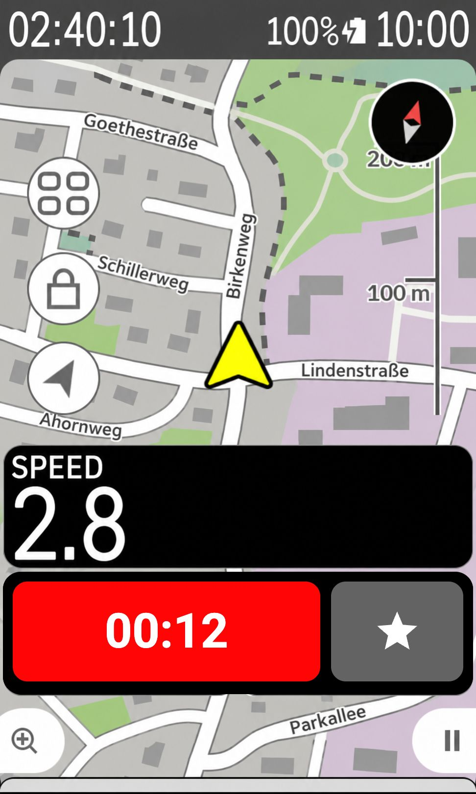
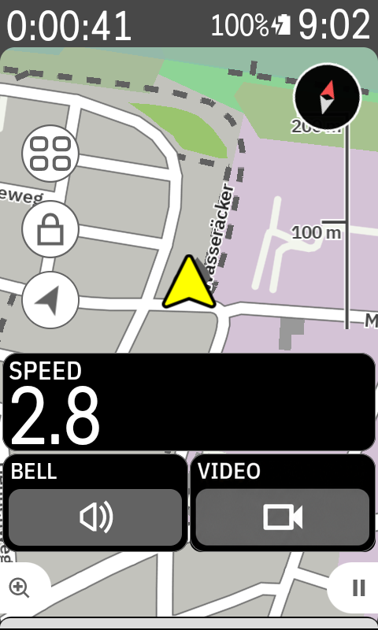
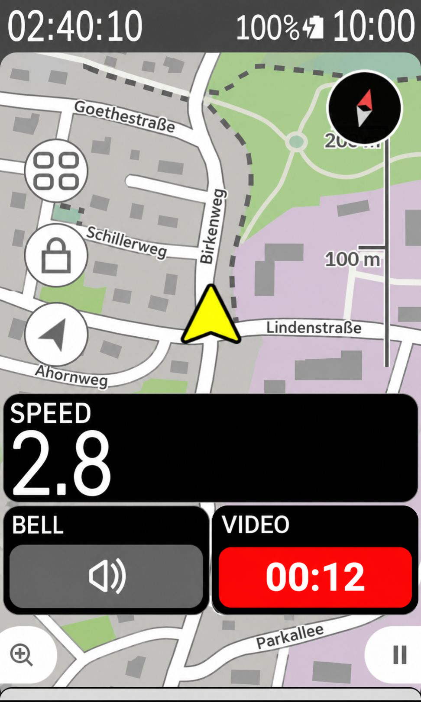
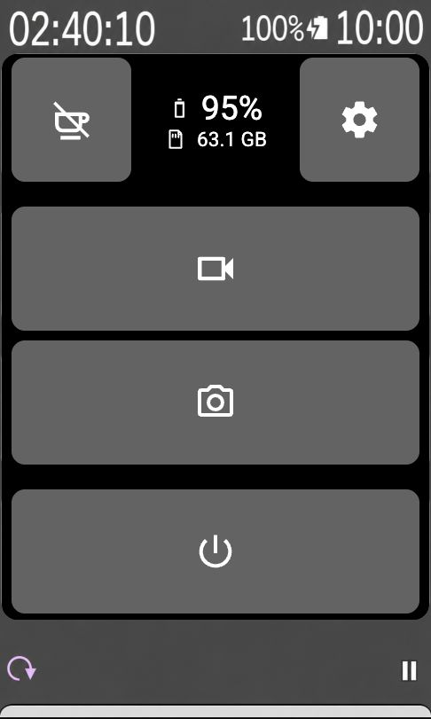
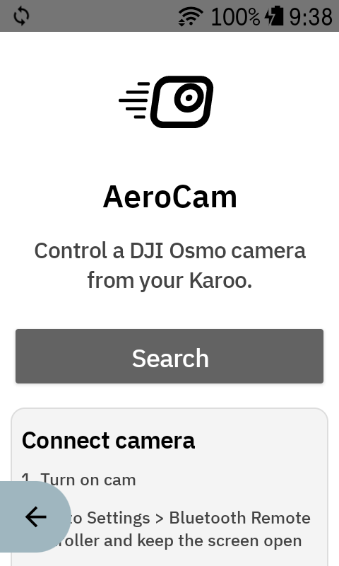
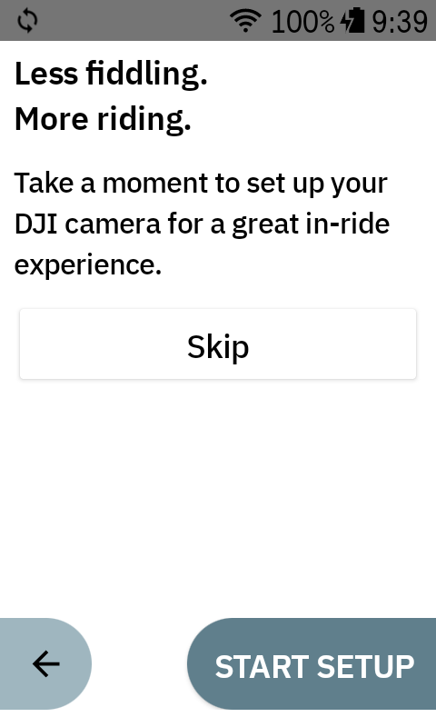
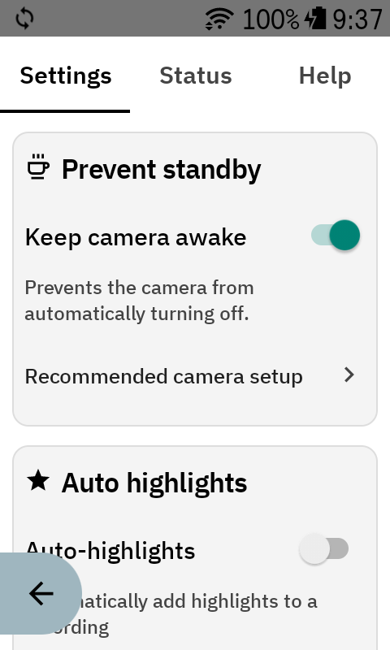
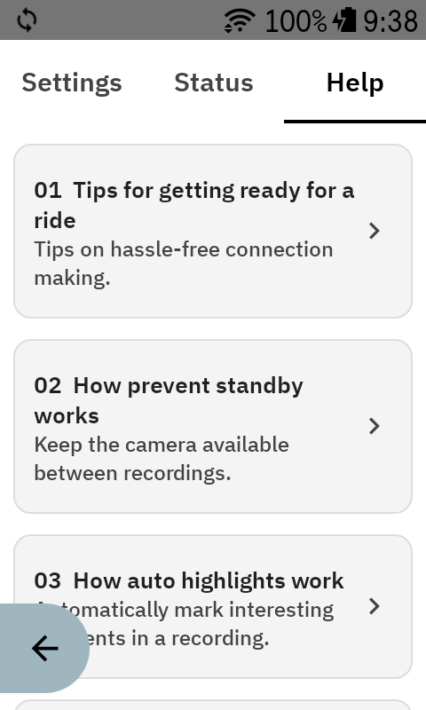

<p align="center">
  
</p>

# AeroCam

[](https://github.com/mtenkoppel/AeroCam/actions/workflows/ci.yml)
[](https://github.com/mtenkoppel/AeroCam/releases)
[](LICENSE)
[](https://kotlinlang.org/)

**Website:** [mtenkoppel.github.io/AeroCam](https://mtenkoppel.github.io/AeroCam/)

AeroCam is an independent Karoo extension for controlling a DJI Osmo Action
camera over Bluetooth Low Energy. It provides in-ride camera controls, automatic
reconnection, GPS telemetry, video highlights, and a configurable keep-awake
mode.

> [!TIP]
> **Built with AI. Shaped and proven by a human.** AeroCam combines AI-driven
> development with hands-on product direction, real-world testing, and human
> supervision. [Read the AI transparency statement](#ai-transparency).

> [!IMPORTANT]
> AeroCam is an independent community project. It is not affiliated with,
> endorsed by, or sponsored by DJI or Hammerhead. DJI and Osmo are trademarks
> of their respective owners.

> [!NOTE]
> DJI cameras cannot currently be woken from a complete power-off through the
> standard Android Bluetooth APIs available on Karoo. AeroCam works around this
> limitation with **Prevent standby**, which keeps a connected camera responsive
> while allowing its screens to remain off. A fully powered-off camera must
> still be turned on manually.

## Screenshots

Fit camera controls beside your map or give Cam Control a page of its own.
The ride previews below show small full-width, half-width, and full-screen
layouts, including the recording state.

<table>
  <tr>
    <th>Video + Photo · small full width</th>
    <th>Video · half width</th>
    <th>Video · recording</th>
    <th>Cam Control · full screen</th>
  </tr>
  <tr>
    <td></td>
    <td></td>
    <td></td>
    <td></td>
  </tr>
</table>

Pair your camera, follow the setup guide, and configure Prevent standby before
heading out. Built-in help stays available on the Karoo.

<table>
  <tr>
    <th>Connect camera</th>
    <th>Camera setup</th>
    <th>Prevent standby</th>
    <th>Help</th>
  </tr>
  <tr>
    <td></td>
    <td></td>
    <td></td>
    <td></td>
  </tr>
</table>

## Features

### Basics

- **Start and stop recording:** Control video recording from an in-ride data
  field or a Karoo bonus action, with immediate input feedback and camera-state
  confirmation.
- **GPS telemetry:** Stream live Karoo position, altitude, and movement data to
  the camera so supported DJI recordings contain telemetry for later overlays.
- **Highlights:** Add DJI highlight markers while recording, making interesting
  moments easier to find during editing.
- **Automatic reconnection:** AeroCam remembers the paired camera and searches
  for it in the background, reconnecting when the camera becomes available.
- **Photo capture:** Take photos directly from a focused data field or the
  full-screen control field.
- **Camera monitoring:** View camera battery and remaining card space, with
  optional one-time alerts for low battery and low storage, plus highlight-added
  feedback.
- **Consistent appearance:** White app menus and black camera controls in ride
  data fields, independent of the Karoo in-ride appearance.
- **Six languages:** English, German, Spanish, French, Italian, and Portuguese
  are selected automatically from the Karoo language.

### Auto Highlights

Auto highlights use Karoo ride data to mark useful moments while a ride and
camera recording are active. Each trigger can be enabled separately, and power,
speed, heart-rate, ascent, and descent thresholds can be customized. Optional
**Auto-start recording** starts recording when a trigger occurs while the camera
is idle; that first event starts the recording rather than adding an immediate
marker.

- **Lap marker:** Adds a highlight whenever Karoo records a new lap.
- **Peak power:** Adds a highlight when power crosses the configured wattage.
- **Maximum speed:** Adds a highlight when speed crosses the configured km/h
  threshold.
- **Climb summit:** Adds a highlight when the ridden distance reaches the summit
  of a climb in the active Karoo route.
- **Peak heart rate:** Adds a highlight when heart rate crosses the configured
  bpm threshold.
- **Ascent and descent:** Separate gradient thresholds for climbs and descents,
  each with an optional minimum speed condition.
- **Ride start/end markers:** Marks the actual ride boundaries only if the camera
  is already recording. No delayed start marker is added when recording begins
  mid-ride. Finishing from a paused ride can add an end marker; pauses and resumes
  themselves do not. Both Auto highlights and this option must be enabled, and
  these markers never start recording. Off for new installations; existing
  choices and the previous default for older installations are preserved.

### Prevent standby
Automatic threshold highlights share a **30-second cooldown** by default. In
Advanced settings, choose **Off, 15, 30, or 60 seconds**. Speed, power,
heart rate, and gradient triggers share this interval. Manual highlights, laps,
climb summits, and ride start/end markers always bypass it. Every successfully sent
highlight starts the interval for subsequent threshold highlights. Suppressed
triggers are discarded, never deferred; the existing threshold reset margins
still apply. Starting a recording alone does not start the cooldown.


Keep awake periodically sends a lightweight camera-control command so the Osmo
does not reach its automatic power-off timeout. This lets the camera remain
connected and ready while its locked screens stay off.

Keeping the camera responsive consumes noticeably more battery than allowing it
to power off, but testing showed it remains practical for up to 3 hour rides.

### Data Fields

- **Photo:** A focused shutter control optimized to remain clear and usable in
  small data-field positions, including beside maps or media controls.
- **Video:** A compact recording control optimized for small data fields, with
  recording duration, highlight control, and temporary action feedback.
- **Video + Photo:** Video on the left and photo on the right while idle. During
  recording, the existing video field takes over, including timer, highlights
  and feedback. Stopping restores both controls.
- **Cam Control:** Best used as a full-screen data field. It combines connection,
  battery, storage, Keep awake, video, photo, camera power-off, and app access in
  one riding dashboard. Settings remains available in compact full-width fields;
  half-width fields show battery and storage.

### Bonus Actions

Karoo bonus actions let supported hardware buttons trigger AeroCam without
opening a data field.

- **Start/Stop Recording:** Toggles video recording.
- **Add Highlight:** Adds a highlight to the active recording.
- **Settings:** Opens AeroCam for configuration and camera status.

## Compatibility

### Cameras

AeroCam has been developed and tested with the **DJI Osmo Action 4**. The Osmo
Action 5 Pro and Osmo Action 6 Pro appear to use a compatible Bluetooth control
protocol, but they have not yet been tested.

### Karoo

AeroCam has been tested only with the **Hammerhead Karoo 3**.

## How It Works

### Pair a Camera

Pairing is required only once:

1. Turn on the camera.
2. On the camera, open **Settings > Bluetooth Remote Controller** and leave that
   screen open.
3. Open AeroCam on the Karoo and press **Search**.
4. Accept the connection and security code shown on the camera.

AeroCam stores the paired camera and will try to reconnect automatically when
the camera is available. After first pairing, an optional guide walks through
camera settings, ride triggers and widgets. Replay it with **Camera setup guide**
in Settings or Help.

### Set Up Prevent standby

Keep awake works best when the camera is configured for low-distraction use:

1. Configure the camera's **QS button** to use the Screen Switch/Photo action
   rather than a voice-prompt action. Menu wording can vary by DJI firmware.
2. Turn off camera sounds or lower their volume so periodic QS commands do not
   produce distracting tones.
3. Configure Single Screen Preview so the front display remains off when the
   camera is locked.
4. Set Auto Power Off to **five minutes**. The new default QS interval is
   **four minutes thirty seconds**, leaving time for acknowledgement retries.
   Previously saved custom intervals remain unchanged. Shorter camera timers
   require a correspondingly shorter app interval; choose the matching timer in the
   advanced settings.
5. After AeroCam connects, lock the camera screen. The displays turn off while
   AeroCam periodically prevents the camera from fully powering down.

Keep awake is a practical standby workaround, not a true DJI standby mode. It
uses additional camera battery and cannot wake a camera after complete
power-off.

### Prepare for a Ride

Once the camera has been paired and configured, a reliable pre-ride workflow is:

1. Check the camera's video settings, including resolution, frame rate, field of
   view, and stabilization.
2. Mount the camera and confirm that you are happy with its point of view.
3. Turn on the Karoo and camera, then confirm that AeroCam reconnects.
4. If you use Keep awake, enable it and lock the camera display before starting
   the ride.

You can then leave the AeroCam app itself in the background and use its data
fields or bonus actions during the ride.

## Install

Download the newest APK from [GitHub Releases](https://github.com/mtenkoppel/AeroCam/releases).
On the Karoo, allow installation from the source you use to transfer the APK,
then open the file and install it. Updates must be signed with the same key as
the installed version; otherwise Android requires the existing app to be
uninstalled first, which also removes AeroCam settings and its saved camera.

Review the release notes before updating.

## Which build should I install?

For device testing, use the **release-signed APK from Signed test build**. It
contains the selected branch's changes and updates the existing app in place.
It does not require a public GitHub release.

| Output | Purpose |
| --- | --- |
| CI debug APK | Automated checks and development; do not use it to replace a release-signed installation. |
| Signed test build: `app-release.apk` | Normal device testing, using the established release key with debugging disabled. |
| Explicitly requested signed debug APK | Troubleshooting only; the same key with debugging enabled. Not the normal test update. |
| Public release APK | A versioned, published build after validation. The tag workflow first creates a draft. |
| Recovery APK | Previous trusted application code rebuilt with a higher version code, for an in-place rollback. |

Keep the current device-test APK and its verified higher-code recovery together.
Older builds remain archived as evidence. Install with `adb install -r`; do not
uninstall or clear app data to switch builds. Check the connected device's version
before installation. The app's version code identifies update order; “signed”
identifies its key, and “debug” identifies whether debugging is enabled.

## Build from source

The validated build combination is Kotlin 2.1.21, Android Gradle Plugin 8.6.1,
Gradle 8.7, and Java 17, with compile SDK 35 / target SDK 34. Karoo Extensions
remains at 1.1.9. These versions were selected for compatibility and tested on
hardware; they are not a claim that every dependency is the newest available.
### Cooldown validation

The cooldown uses the existing karoo-ext 1.1.9 integration; no SDK or KOS
requirement changes. Official 1.1.9 release notes specify KOS 1.634.2440 or later:
https://github.com/hammerheadnav/karoo-ext/releases/tag/1.1.9
No Karoo or camera firmware has been physically tested for this change.

### Requirements

- JDK 17 and Android SDK command-line tools (Android Studio is optional)
- Android SDK 35
- A GitHub account and token with `read:packages`
- A Karoo in developer mode for USB deployment

The Gradle wrapper is included, so a separate Gradle installation is not
required.

1. Clone the repository:

   ```sh
   git clone https://github.com/mtenkoppel/AeroCam.git
   cd AeroCam
   ```

2. Copy `local.properties.example` to `local.properties` and provide access to
   Hammerhead's GitHub Package:

   ```properties
   sdk.dir=/Users/you/Library/Android/sdk
   gpr.user=your-github-username
   gpr.key=your-github-token
   ```

   `local.properties` is ignored by Git. CI can instead use `GITHUB_ACTOR` and
   `GITHUB_TOKEN`.

3. Build and test:

   ```sh
   ./gradlew testDebugUnitTest assembleDebug
   ```

   The APK is created at `app/build/outputs/apk/debug/app-debug.apk`.

4. Connect the Karoo over USB-C, approve USB debugging, and install without
   clearing existing app data:

   ```sh
   adb devices
   ./scripts/install-debug.sh
   ```

To open an installed build, run `./scripts/launch-app.sh`. To follow AeroCam's
logs, run `./scripts/logcat.sh` or use Android Studio's Logcat window.

### Signing

Android accepts an update only when it is signed by the same key as the
installed app. Local debug builds normally use `~/.android/debug.keystore`.
Public releases must use one dedicated release key that is backed up securely;
losing it prevents future in-place updates.

The release workflow expects these GitHub Actions secrets:
`RELEASE_KEYSTORE_BASE64`, `RELEASE_KEYSTORE_PASSWORD`, `RELEASE_KEY_ALIAS`,
and `RELEASE_KEY_PASSWORD`. Never commit a keystore or its passwords.

## Releases

Source code is versioned with Git tags such as `v0.9.0-beta.1`. Installable APKs
belong on the corresponding GitHub Release rather than in Git history. Each
release should contain release notes, the APK, and its SHA-256 checksum.

## Dependencies and acknowledgements

- [Hammerhead Karoo Extension SDK](https://github.com/hammerheadnav/karoo-ext)
  (`io.hammerhead:karoo-ext`), Apache License 2.0
- Kotlin and the Android Gradle Plugin, used by the build toolchain
- JUnit 4, used only for tests

See [THIRD_PARTY_NOTICES.md](THIRD_PARTY_NOTICES.md) for attribution details.

The following projects were studied while implementing and validating the BLE
behavior. They are references, not bundled dependencies:

- [DJI Osmo GPS Controller Demo](https://github.com/dji-sdk/Osmo-GPS-Controller-Demo)
- [ClipRide GoPro extension for Karoo](https://github.com/yrkan/clipride)
- [DJI Remote](https://github.com/rhoenschrat/DJI-Remote)
- [M5StickC Plus 2 Remote for DJI Osmo](https://github.com/theserialhobbyist/M5StickCPlus2_Remote_For_DJI_Osmo)

## AI transparency

The AeroCam code was written exclusively by large language models (LLMs),
working from human-provided requirements and feedback.

- Similar projects, including the ClipRide GoPro extension and DJI's sample
  project, were analyzed automatically to learn from their lifecycle handling
  and technical implementation.
- Hammerhead's Karoo documentation and extension SDK were analyzed
  automatically to understand the available platform features and integration
  points.
- The unique human contributions were developing the product and interaction
  design, discovering the Keep awake workaround for the camera's standby
  limitation after the LLM could not solve remote wake-up, and testing the
  software on real Karoo and DJI hardware.
- Development was iterative rather than a single-shot generation. AeroCam
  progressed from small proofs of concept to a stable beta in approximately 12
  hours of active development.
- Approximately EUR 30-60 in Euros were used during development.
- This transparency statement was also written by an LLM from human-provided
  requirements.

Human testing cannot cover every device state, firmware version, or riding
condition. Review changes and test them before relying on the software.

## Warranty and liability

AeroCam is provided **as is**, without warranty of any kind. The authors and
copyright holders are not liable for damage, data loss, missed recordings,
device behavior, or other claims arising from its use. The complete legal terms
are in the [GNU General Public License v3.0](LICENSE).

## License

Copyright (C) 2026 Maurice ten Koppel.

AeroCam is licensed under the [GNU General Public License v3.0](LICENSE)
(`GPL-3.0-only`). Distributed modified versions must provide corresponding
source code under the same license. GPLv3 permits commercial use and resale;
its purpose here is to ensure that distributed derivatives remain open.
